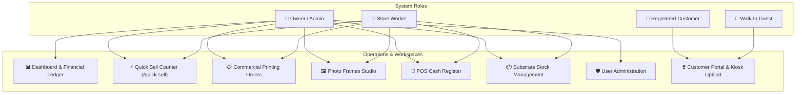
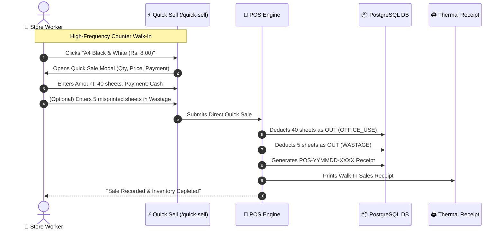
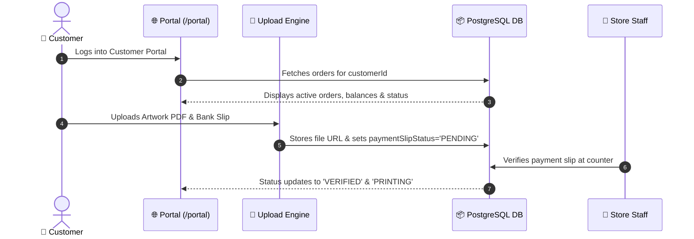

# Nirmana Printing Management System — End-to-End System Scenarios & Role Guide

> **System Version:** 1.0.0 (Production Live)  
> **Architecture:** Lakebase PostgreSQL (Neon Cloud) &bull; Node.js Express &bull; EJS & Hotwire Turbo &bull; Bootstrap 5.3 + Serene Workshop Design System  
> **Production URL:** [https://nirmanaprinting-eta.vercel.app](https://nirmanaprinting-eta.vercel.app)

---

## 1. Executive System Overview

**Nirmana Printing Management System** is an enterprise-grade point-of-sale, inventory tracking, photo frames studio, and print production management platform tailored for high-volume commercial print shops.

### Core Architecture Highlights
1. **Separated Workspaces**: Strict segregation between Ordinary Commercial Print Orders (`/orders`), Photo Frames Studio (`/orders?type=frame`), Quick Sell Counter (`/quick-sell`), Express Kiosk Print (`/quick-print`), and POS Retail (`/pos`).
2. **Real-Time Material Depletion**: Automatic stock reduction upon job intake and counter sales, categorized as **Office Use** (internal store consumption) and **Wastage** (damaged / misprinted sheets).
3. **End-of-Day Financial Ledger**: Comprehensive audit of daily cash inflow, advance collections, raw materials consumption costs, and net operating cash balance with printable signature slips.
4. **Adaptive Dark & Light Mode Theme**: Universal high-contrast design system featuring dark slate/navy surfaces, crisp typography, and non-glare colored status indicators.

---

## 2. User Roles Matrix & Access Permissions

| Subsystem / Feature | Owner / Admin (`ADMIN`) | Store Worker (`WORKER` / `STAFF`) | Registered Customer (`CUSTOMER`) | Walk-in / Guest (`ANONYMOUS`) |
| :--- | :---: | :---: | :---: | :---: |
| **Print Shop Dashboard** (`/dashboard`) | Full Access (Financials + KPIs) | Operational Access | ❌ Forbidden | ❌ Forbidden |
| **Quick Sell Counter** (`/quick-sell`) | Full Access | Full Access | ❌ Forbidden | ❌ Forbidden |
| **Commercial Orders** (`/orders`) | Full Intake & Edit & Delete | Intake, Status & Payments | ❌ Forbidden | ❌ Forbidden |
| **Photo Frames Studio** (`/orders?type=frame`) | Full Intake & Pricing | Full Intake & Assembly | ❌ Forbidden | ❌ Forbidden |
| **POS Cash Register** (`/pos`) | Full Register & Void | Counter Billing & Receipts | ❌ Forbidden | ❌ Forbidden |
| **Stock Management** (`/stock`) | Full In/Out, Costs & Alerts | Stock Out & Wastage Log | ❌ Forbidden | ❌ Forbidden |
| **Products & Catalog** (`/products`) | Create & Edit Catalog | View Catalog | View Catalog | View Public Catalog |
| **Customers & Accounts** (`/customers`) | Full Ledger & Debt View | Search & Order History | ❌ Forbidden | ❌ Forbidden |
| **User Administration** (`/users`) | Full User Creation & Roles | ❌ Forbidden | ❌ Forbidden | ❌ Forbidden |
| **End-of-Day Audit** (`/dashboard#dailyBusinessCard`) | Full Audit & Print Slip | View Day Totals | ❌ Forbidden | ❌ Forbidden |
| **Customer Portal** (`/portal`) | Preview Mode | Preview Mode | Personal Orders & Slips | ❌ Forbidden |
| **Self-Service File Upload** (`/upload`) | Test Upload | Test Upload | Upload with Account | Instant QR Upload |

---

## 3. Role-by-Role Operational Scenarios



---

### ROLE 1: Shop Owner / Administrator (`ADMIN` / `OWNER`)

The Owner/Admin exercises full administrative authority, monitors daily financials, controls inventory costs and thresholds, manages staff accounts, and authorizes end-of-day cash closings.

#### Scenario 1.1: Morning Shop Opening & Inventory Health Audit
* **Context:** The owner arrives at 8:00 AM to review shop readiness before opening doors.
* **Steps:**
  1. Navigates to [`/dashboard`](https://nirmanaprinting-eta.vercel.app/dashboard).
  2. Inspects top action toolbar: The **Stock Attention** button pulses red showing `Low Stock: 1`.
  3. Clicks **Stock Attention** to open the modal: Identifies that `A4 80GSM Copier Paper` has dropped to 20 sheets (below the reorder threshold of 30 sheets).
  4. Clicks **+ Add Stock** directly from the modal to open the **Stock In (Arrival)** drawer.
  5. Reviews the **Active Queue** (3 orders in production) and verifies staff schedules.

#### Scenario 1.2: Stock Restock & Batch Cost Pricing
* **Context:** A paper supplier delivers 500 sheets of A3 Matte Art Paper.
* **Steps:**
  1. Navigates to [`/stock`](https://nirmanaprinting-eta.vercel.app/stock) or clicks **Stock In** on the dashboard.
  2. Selects `A3 Matte Art Board 250GSM`, enters Quantity: `500 Sheets`, Supplier: `Union Paper Mills`, Batch Buying Cost: `Rs. 12.50 / sheet`, Selling Price: `Rs. 25.00 / sheet`.
  3. The system computes live estimated profit (+Rs. 12.50/unit, 50% gross margin).
  4. Submits the form: The inventory balance increases from 50 to 550 sheets. An arrival ledger record (`Type: IN, Category: PURCHASE`) is generated.

#### Scenario 1.3: User Account Administration & Access Control
* **Context:** A newly hired counter assistant joins the shop, and a former worker resigns.
* **Steps:**
  1. Navigates to [`/users`](https://nirmanaprinting-eta.vercel.app/users) (exclusive to `ADMIN` / `OWNER`).
  2. Clicks **Add New User**: Enters username `sanduni_worker`, full name `Sanduni Perera`, phone `0772345678`, password, and selects Role: `Store Worker (WORKER)`.
  3. Finds the resigned worker's account and toggles **Status: Inactive** to prevent unauthorized login.

#### Scenario 1.4: Catalog Pricing & Rate Card Setup
* **Context:** Commercial ink and paper import duties increase; the owner updates standard product rates.
* **Steps:**
  1. Navigates to [`/products`](https://nirmanaprinting-eta.vercel.app/products).
  2. Selects `Standard Color Photocopy A4` -> edits base price from `Rs. 20.00` to `Rs. 25.00`.
  3. Both the public catalog and staff POS pick up the updated rate card immediately.

#### Scenario 1.5: End-of-Day Financial Closing & Printable Slip Audit
* **Context:** At 8:30 PM closing, the owner performs the daily financial audit.
* **Steps:**
  1. Navigates to `/dashboard#dailyBusinessCard`.
  2. Audits the 4 Financial Metric Cards:
     - **Total Money Collected Today**: Cash Inflow breakdown across Photo Frames, General Print, Quick Print, and Retail Counter.
     - **Total Business Booked**: Gross value of all orders and POS receipts.
     - **Consumed Materials Cost**: Total cost of raw sheets consumed (`Job Stock + Office Use`).
     - **Net Operating Cash Balance**: `Total Money Collected - Materials Consumed Cost`.
  3. Clicks **Print Day Slip**: A formatted thermal/slip opens in a pop-up window showing payment methods, cashier breakdown, and signature boxes for **Cashier Signature** and **Owner / Manager Approval**.
  4. Prints and signs the day-end financial slip for filing.

---

### ROLE 2: Counter / Store Worker (`WORKER` / `STAFF`)

Store Workers operate the front desk, run quick walk-in sales, take print and custom frame orders, track production stages, deduct materials, and record machine misprints.



#### Scenario 2.1: The 1-Click Quick Sell Counter (`/quick-sell`)
* **Context:** A walk-in customer requests 40 black-and-white A4 printouts and pays cash immediately.
* **Steps:**
  1. Worker clicks **Quick Sell** in the left sidebar to open [`/quick-sell`](https://nirmanaprinting-eta.vercel.app/quick-sell).
  2. Clicks the **A4 Black and White** card (Code: `STK-A4-BW`, Price: `Rs. 8.00`).
  3. Modal appears with pre-filled name and unit price. Worker enters Quantity: `40`.
  4. System calculates total: `Rs. 320.00`. Payment method is set to `Cash`.
  5. Submits:
     - **POS Sale generated**: Receipt `#POS-261111-XXXX` created.
     - **Stock depleted**: 40 sheets are deducted from `STK-A4-BW` and logged under **Office Use** (internal consumption).
     - Customer receives thermal receipt and prints.

#### Scenario 2.2: Misprint & Machine Jam Wastage Logging
* **Context:** During printing, the laser printer jams and ruins 10 A3 color sheets.
* **Steps:**
  1. Worker opens `/quick-sell` or `/stock`.
  2. Clicks **⚠️ Manual Wastage Removal** (or the red Wastage button on the A3 Color card).
  3. Selects `A3 Color (STK-A3-CLR)`, enters Quantity: `10 Sheets`, Reason: `WASTAGE (Print Trial / Scrap Wastage)`, Notes: `Toner alignment smear and paper roller jam`.
  4. Submits: The system deducts 10 sheets from inventory with `Type: OUT, Category: WASTAGE`.
  5. The store owner can inspect the damage write-off in the End-of-Day ledger.

#### Scenario 2.3: Commercial Bulk Print Order Intake & Execution
* **Context:** A school orders 1,000 sports meet certificates on 200GSM Ivory Board, paying Rs. 5,000 advance with Rs. 10,000 balance due on delivery.
* **Steps:**
  1. Worker clicks **Printing Orders** -> **+ New Order** ([`/orders/new`](https://nirmanaprinting-eta.vercel.app/orders/new)).
  2. The page loads dedicated **Commercial & General Printing Order** (with photo frames strictly excluded).
  3. Worker enters customer phone: `0771234567`. System auto-detects existing account or creates new customer profile.
  4. Enters Job Title: `Sports Meet Certificates 1000 Pcs`, Total: `Rs. 15,000.00`, Advance: `Rs. 5,000.00`, Due Date: `Nov 18, 2026`.
  5. Selects Paper Substrate: `Ivory Board 200GSM` -> Enters Quantity: `1000 Sheets`.
  6. Submits:
     - Order `#ORD-2026-XXXX` created.
     - Advance payment of Rs. 5,000 logged under today's cash collections.
     - 1,000 sheets automatically deducted from raw inventory and logged as **Office Use**.
  7. As printing progresses, worker changes status: `RECEIVED` &rarr; `PRINTING` &rarr; `READY`.
  8. When school picks up certificates, worker clicks **Record Payment**: settles Rs. 10,000 via Card. System synchronizes POS sale and marks order `PAID / COMPLETED`.

#### Scenario 2.4: Photo Frames Studio Custom Framing Order
* **Context:** A client brings a 12" x 18" wedding portrait photograph to be framed with teak wood, non-reflective glass, and an ivory mount board.
* **Steps:**
  1. Worker clicks **Photo Frames Studio** ([`/orders?type=frame`](https://nirmanaprinting-eta.vercel.app/orders?type=frame)) in the sidebar.
  2. Clicks **+ New Custom Frame**:
     - Frame Type: `Teak Wood 1.5" Natural Moulding`.
     - Dimensions: `Width: 12 inches`, `Height: 18 inches`.
     - Glass Type: `Non-Reflective Matt Glass`.
     - Mount Board: `Ivory White 2-inch border`.
  3. Total calculated: `Rs. 3,600.00`. Customer pays Rs. 1,600 advance via Bank Transfer.
  4. Submits: Frame order is isolated in the Photo Frames Studio workspace and will NOT clutter ordinary print order lists.
  5. On completion, balance of Rs. 2,000 is settled and tagged as Photo Frames revenue in the daily audit.

#### Scenario 2.5: Point of Sale (POS) Counter Retail Billing
* **Context:** A walk-in customer purchases 2 pre-made photo frames and 4 certificate laminating pouches from the store shelf.
* **Steps:**
  1. Worker opens [`/pos`](https://nirmanaprinting-eta.vercel.app/pos).
  2. Adds `8x10 Ready-Made Wooden Photo Frame` (Qty: 2 @ Rs. 650.00) and `A4 Lamination Pouch` (Qty: 4 @ Rs. 50.00).
  3. Total: `Rs. 1,500.00`. Selects `Card Payment`, swipes customer card, enters authorization code, and clicks **Complete Sale & Print Receipt**.
  4. POS sales ledger updates immediately with receipt `#POS-YYMMDD-XXXX`.

#### Scenario 2.6: Express Quick Print (QR Kiosk) Queue Processing
* **Context:** A university student arrives, scans the front-desk QR code, uploads a project report PDF, and receives token `QP-042`.
* **Steps:**
  1. A red badge appears on **Quick Print (QR)** in the worker's sidebar showing `1 NEW`.
  2. Worker clicks [`/quick-print`](https://nirmanaprinting-eta.vercel.app/quick-print).
  3. Sees token `QP-042`: 1 document, 25 pages, Color, Double-Sided, A4 80GSM.
  4. Worker clicks **Send to Digital Copier**, collects prints, clicks **Complete & Collect Payment** (`Rs. 500.00`), and hands prints to student.

---

### ROLE 3: Regular Registered Customer (`CUSTOMER`)

Registered customers have portal access to track active printing projects, download invoices, submit design files, and upload bank transfer receipts.



#### Scenario 3.1: Logging into Customer Portal & Tracking Jobs
* **Steps:**
  1. Customer visits [`https://nirmanaprinting-eta.vercel.app/login`](https://nirmanaprinting-eta.vercel.app/login) and signs in.
  2. System detects `role === 'CUSTOMER'` and redirects to [`/portal`](https://nirmanaprinting-eta.vercel.app/portal).
  3. Customer views active jobs ribbon:
     - `ORD-2026-0004`: `PRINTING` &bull; Due: Nov 15 &bull; Balance Due: `Rs. 1,000.00`.
  4. Clicks **View Slip / Invoice** to download the official print order slip.

#### Scenario 3.2: Self-Service Design Artwork Upload
* **Steps:**
  1. Customer clicks **Upload Print Files** ([`/upload`](https://nirmanaprinting-eta.vercel.app/upload)).
  2. Drags and drops a high-resolution PDF `Banner_Design_Final.pdf`.
  3. Selects specifications: `Single Sided`, `Color`, `Large Format Vinyl Banner`.
  4. Adds note: `Please check margins and color balance before printing`. Submits job.

#### Scenario 3.3: Bank Transfer Slip Submission
* **Steps:**
  1. Customer transfers Rs. 1,000 balance via online banking.
  2. In `/portal`, locates order `ORD-2026-0004` -> clicks **Upload Payment Slip**.
  3. Attaches screenshot of bank receipt with reference `TRX984210`.
  4. Store worker verifies the transfer and marks payment settled.

---

### ROLE 4: Walk-in Anonymous Guest (`ANONYMOUS`)

Walk-in visitors can interact with self-service kiosk stations and public catalogs without needing an account.

#### Scenario 4.1: Instant QR Kiosk Document Upload
* **Steps:**
  1. Guest walks up to Nirmana counter, scans the QR code sticker using their mobile phone camera.
  2. Mobile browser opens [`/upload`](https://nirmanaprinting-eta.vercel.app/upload) directly.
  3. Guest selects PDF document, chooses `Black and White`, `Double-Sided`, `2 Copies`.
  4. Taps **Upload & Get Token**: Mobile screen displays token **`QP-019`**.
  5. Guest quotes token `QP-019` to the worker at the counter.

#### Scenario 4.2: Browsing Public Products & Print Rate Card
* **Steps:**
  1. Guest visits [`https://nirmanaprinting-eta.vercel.app/products`](https://nirmanaprinting-eta.vercel.app/products).
  2. Browses standard rates:
     - `A4 Black & White`: Rs. 8.00
     - `A3 B&W`: Rs. 15.00
     - `A4 Color`: Rs. 20.00
     - `A3 Color`: Rs. 40.00
     - `A4 Sticker Sheet`: Rs. 120.00
     - Custom Framing: Rates per square inch.

---

## 4. Inventory Auto-Deduction & Wastage Mathematical Engine

```
                             [ RAW INVENTORY ]
                                     |
           +-------------------------+-------------------------+
           |                                                   |
    [ STOCK IN ]                                        [ STOCK OUT ]
 (Arrival Restock)                                             |
   Current + Qty                               +---------------+---------------+
                                               |                               |
                                        [ OFFICE USE ]                    [ WASTAGE ]
                                  (Auto Production / Counter)       (Misprints & Jammed Sheets)
                                     Current - Job Qty                Current - Wasted Qty
```

### Formula Specifications

1. **Stock Arrival (Restock)**
   $$\text{Current Stock}_{\text{new}} = \text{Current Stock}_{\text{old}} + \text{Received Qty}$$
   $$\text{Weighted Unit Cost} = \frac{(\text{Stock}_{\text{old}} \times \text{Cost}_{\text{old}}) + (\text{Qty}_{\text{new}} \times \text{Cost}_{\text{new}})}{\text{Current Stock}_{\text{new}}}$$

2. **Quick Sell Auto-Depletion**
   $$\text{Total Deducted} = \text{Sold Quantity} + \text{Wastage Quantity}$$
   $$\text{Current Stock}_{\text{new}} = \max(0, \text{Current Stock}_{\text{old}} - \text{Total Deducted})$$
   - `Sold Quantity` &rarr; Logged as `Type: OUT, Category: OFFICE_USE`
   - `Wastage Quantity` &rarr; Logged as `Type: OUT, Category: WASTAGE`

3. **Commercial Print Order Material Depletion**
   $$\text{Current Stock}_{\text{new}} = \max(0, \text{Current Stock}_{\text{old}} - (\text{Order Material Qty} + \text{Wastage Qty}))$$

4. **Net Operating Daily Balance**
   $$\text{Net Operating Cash Balance} = \text{Total Money Collected Today} - \text{Material Usage Cost Today}$$
   Where:
   $$\text{Material Usage Cost Today} = \sum (\text{Office Use Sheets} \times \text{Unit Cost}) + \sum (\text{Wasted Sheets} \times \text{Unit Cost})$$

---

## 5. Dark Mode & Light Mode Theme Specifications

The application uses an adaptive theme engine that persists user preference in `localStorage`:

* **Theme Switching Mechanism**: Handled globally via `window.toggleDarkMode()`.
* **Instant Bootstrap Script**: Embedded in HTML `<head>` of [`src/views/partials/header.ejs`](file:///src/views/partials/header.ejs) to eliminate White/Dark theme flash on page load.
* **Dark Theme Surface Tokens**:
  - Main Body: `--serene-bg: #0b1120`
  - Card Surfaces: `--serene-surface: #111827`
  - Subtle Headers & Table Headings: `#162036`
  - Modal Contents: `#131b2e`
  - Subtle Borders: `--serene-border: #1f2937`
  - High-Contrast Text: `--serene-text-main: #f8fafc`
  - Muted Text: `--serene-text-muted: #94a3b8`
* **Warning / Yellow Contrast Protection**:
  - Yellow buttons (`.btn-warning`) and badges (`.badge.bg-warning`) strictly enforce dark text (`#0f172a`) in dark mode to prevent illegible white-on-yellow text.

---

## 6. Verification & Automated Test Coverage

The system is tested across all functional subsystems with automatic teardown of test fixtures:

1. **`test/streamlined_test.js`**: 10/10 tests covering Stock In, Stock Out, Over-deduction prevention, Automatic customer account creation, Order status progression, Pagination, Profit calculations, and 10-digit phone number validations.
2. **`test/print_order_material_deduction_and_removal_test.js`**: Verifies ordinary print order isolation from photo frames, auto-reduction of 40 sheets, and manual removal of 10 misprinted sheets.
3. **`test/quick_sell_bar_and_inventory_reduction_test.js`**: Verifies the dedicated `/quick-sell` counter page, walk-in 1-click sales of 5 materials, auto-office use reduction, and simultaneous wastage deduction.
4. **`test/photo_frame_studio_isolation_test.js`**: Verifies strict two-way isolation between Photo Frames Studio and Commercial Print orders, custom dimensions, and revenue reporting.
5. **`test/all_scenarios_validation.js`**: End-to-end multi-role validation of all 9 operational scenario groups on live PostgreSQL.

---

## 7. Production Deployment & Live Links

* **Live Production URL**: [https://nirmanaprinting-eta.vercel.app](https://nirmanaprinting-eta.vercel.app)
* **Quick Sell Counter**: [https://nirmanaprinting-eta.vercel.app/quick-sell](https://nirmanaprinting-eta.vercel.app/quick-sell)
* **Print Shop Dashboard**: [https://nirmanaprinting-eta.vercel.app/dashboard](https://nirmanaprinting-eta.vercel.app/dashboard)
* **Photo Frames Studio**: [https://nirmanaprinting-eta.vercel.app/orders?type=frame](https://nirmanaprinting-eta.vercel.app/orders?type=frame)
* **Commercial Orders**: [https://nirmanaprinting-eta.vercel.app/orders](https://nirmanaprinting-eta.vercel.app/orders)
* **Point of Sale (POS)**: [https://nirmanaprinting-eta.vercel.app/pos](https://nirmanaprinting-eta.vercel.app/pos)
* **Stock & Materials**: [https://nirmanaprinting-eta.vercel.app/stock](https://nirmanaprinting-eta.vercel.app/stock)
* **Customer Portal**: [https://nirmanaprinting-eta.vercel.app/portal](https://nirmanaprinting-eta.vercel.app/portal)
* **Kiosk Self-Service Upload**: [https://nirmanaprinting-eta.vercel.app/upload](https://nirmanaprinting-eta.vercel.app/upload)

